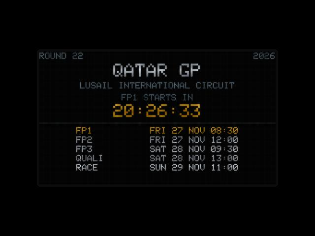
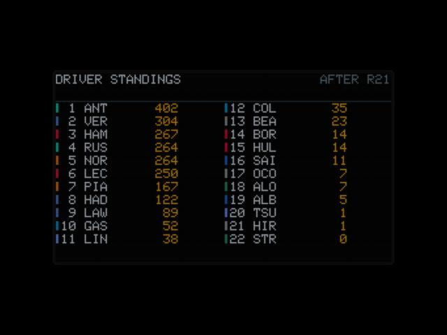

<div align="center">

# 🏁 RaceBoard

**A dot-matrix LED Formula 1 timing board for your TV.**

</div>

RaceBoard turns any browser, and any TV with a Chromecast or a spare Raspberry
Pi, into a live F1 timing tower: the whole field, gaps and intervals, tyres,
pit stops, flags and race control messages, updating as it happens. Between
sessions it counts down to the next one and cycles through the standings and
the last result.

It's FlightBoard's sibling and works the same way: an emulated LED panel, a
real framebuffer and the Adafruit GFX bitmap font, every dot an individually
lit LED.

**No subscription and no account.** RaceBoard reads the same public live timing
feed as the timing page on formula1.com, which needs no login for timing data.

| | |
|---|---|
|  |  |
| **During a session:** all 22 cars at once | **Between sessions:** countdown and weekend schedule |
|  |  |
| **Driver standings** (constructors too) | **The last race's result** |

---

## What it shows

**During a session** (from 15 minutes before it starts until 90 minutes after
it ends):

- the running order in two columns of eleven, each car with its team colour
- a value column that cycles every 8 s: interval, gap to the leader and last
  lap in a race; best lap and gap in practice and qualifying
- the current tyre and its age, `IN PIT` / `PIT EXIT` / `STOPPED` / `OUT`
- fastest lap holder in purple; knocked-out qualifiers dimmed
- laps (race) or session clock (practice, qualifying)
- track status: green, yellow, safety car, VSC, red flag and chequered flag
  fill the whole band
- the latest race control message along the bottom, or the weather

**Between sessions:** the next Grand Prix with a countdown to its next session
and the weekend's schedule in your time zone, then driver standings,
constructor standings and the last race's result, 12 s each.

## Where the data comes from

| What | Source | Notes |
|---|---|---|
| Live timing | `livetiming.formula1.com/signalrcore` | F1's own feed. Unofficial and undocumented; no login needed for timing. Car telemetry and GPS need an F1 TV login, so RaceBoard doesn't use them. |
| Schedule, standings, results | [Jolpica](https://github.com/jolpica/jolpica-f1) (`api.jolpi.ca`) | The successor to the Ergast API. Free, no key. |

F1 can change the live feed whenever it likes. If the feed stops answering,
the board falls back to the schedule pages, and a feed that drops mid-session
shows `NO FEED` in the corner instead of freezing silently.

## The spoiler delay

The timing feed runs **ahead of every TV broadcast**, often by a lot on a
streaming service. With no delay, the board shows a pass before you see it.
Set `RACEBOARD_DELAY_S` in `raceboard.env` to hold every update that many
seconds. Start around 30 and adjust until the board moves just after the TV.

## Install

Same as FlightBoard: Python 3.10+, a virtualenv and one systemd unit.

```bash
git clone https://github.com/gonzalu/RaceBoard.git ~/RaceBoard
cd ~/RaceBoard
python3 -m venv .venv
.venv/bin/pip install -r backend/requirements.txt
cp raceboard.env.example raceboard.env      # then edit: delay, time zone
```

Try it:

```bash
set -a; . ./raceboard.env; set +a
.venv/bin/uvicorn backend.main:app --host 0.0.0.0 --port 8093
```

Open `http://<that machine's address>:8093/`.

Run it at boot:

```bash
sed "s#YOUR-USER#$USER#g" raceboard.service | sudo tee /etc/systemd/system/raceboard.service >/dev/null
sudo systemctl daemon-reload && sudo systemctl enable --now raceboard
```

## Getting it onto a TV

Exactly as with FlightBoard: cast `http://<server IP>:8093/` with
[catt](https://github.com/skorokithakis/catt) (`catt -d "Living Room TV" cast_site http://10.0.1.x:8093/`),
or open it full screen in a browser on a Pi. Use the IP address, not a name:
Chromecasts ignore your router's DNS.

The page reloads itself when the frontend changes on the server, so a cast TV
picks up updates without being re-cast.

## Recording and replay

F1 no longer serves its session archive without a login, so RaceBoard keeps
its own. Every live session's raw feed is written to `data/recordings/`
(`RACEBOARD_RECORD=0` turns that off). Play one back to work on the board
between race weekends:

```bash
RACEBOARD_REPLAY=data/recordings/2026-11-29_Qatar_Grand_Prix_Race.jsonl \
RACEBOARD_REPLAY_SPEED=4 \
  .venv/bin/uvicorn backend.main:app --port 8093
```

A plain snapshot (one JSON object, the hub's answer to a subscribe) also
works; it shows that moment frozen.

## Configuration

All in `raceboard.env`; see `raceboard.env.example` for the full list.

| Variable | Default | |
|---|---|---|
| `RACEBOARD_DELAY_S` | `0` | Spoiler delay, seconds |
| `RACEBOARD_TZ` | server's zone | Time zone for session times, e.g. `America/New_York` |
| `RACEBOARD_RESULT_HOLD_MIN` | `90` | Minutes a finished session's classification stays up |
| `RACEBOARD_PRE_SESSION_MIN` | `15` | Minutes before a session the tower appears |
| `RACEBOARD_RECORD` | `1` | Record live sessions to `data/recordings/` |
| `RACEBOARD_REPLAY` | | Replay a recording instead of the live feed |
| `RACEBOARD_REPLAY_SPEED` | `1` | Replay speed multiplier |

## License

Apache 2.0. The bitmap font is Adafruit's glcdfont (BSD). Formula 1, F1 and
team names are trademarks of their owners; RaceBoard is not affiliated with
or endorsed by Formula 1.
