<div align="center">

# 🏁 RaceBoard

**A dot-matrix LED Formula 1 timing board for your TV.**

</div>

RaceBoard turns any browser, and any TV with a Chromecast or a spare Raspberry
Pi, into a live F1 timing tower: the whole field, gaps and intervals, tyres,
pit stops, flags and race control messages, updating as it happens. Between
sessions it counts down to the next one and cycles through the track, the
standings, the latest results and what happened in F1 on this day, with each
driver's flag beside their name. MotoGP gets its own timing tower and pages
too, with F1 first when both are on.

It isn't styled to look like an LED panel, it emulates one: a real
framebuffer, text drawn from the Adafruit GFX bitmap font that LED matrix
hardware uses, and every dot an individually lit LED.

**No subscription and no account.** RaceBoard reads the same public live timing
feed as the timing page on formula1.com, which needs no login for timing data.

<div align="center">

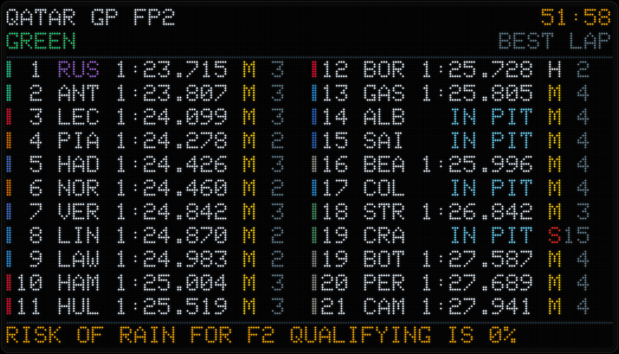

*Practice under yellow, VSC and red flags, a race with its alerts, then the
pages between sessions: the next race, the track, the standings, the last
result and on this day.*

**▶ [Watch the walkthrough on YouTube](https://youtu.be/_0CmI_roeq4)**

</div>

| | |
|---|---|
| 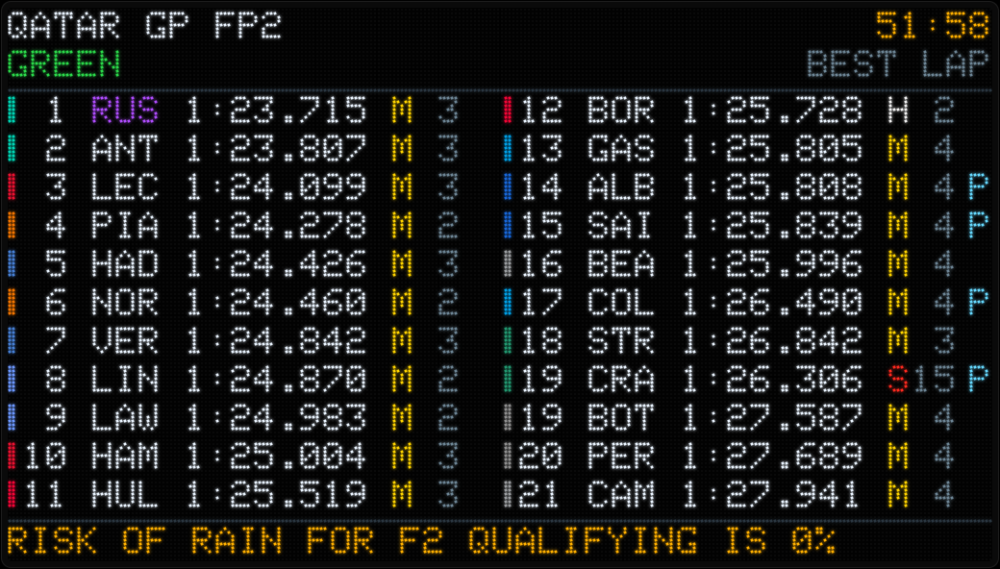 | 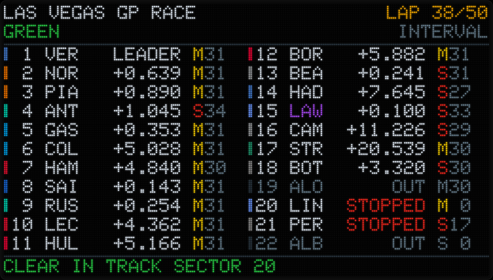 |
| **Practice and qualifying:** all 22 cars, best laps, tyres | **A race:** intervals, tyres, cars stopped and out |
| 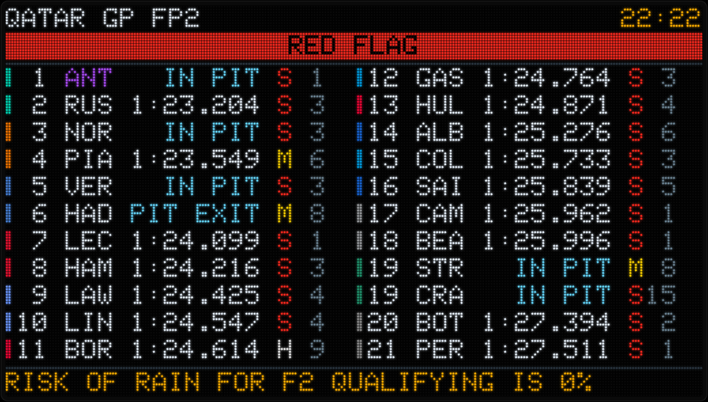 | 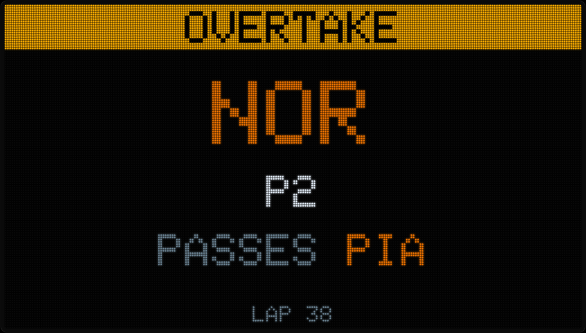 |
| **Flags** fill the band across the top | **Alerts** take over for overtakes, battles and flags |
| 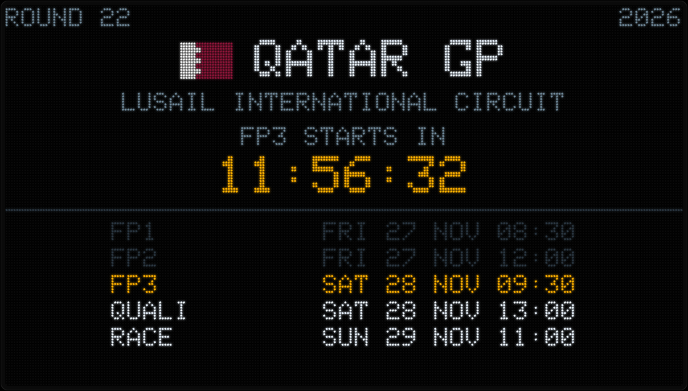 | 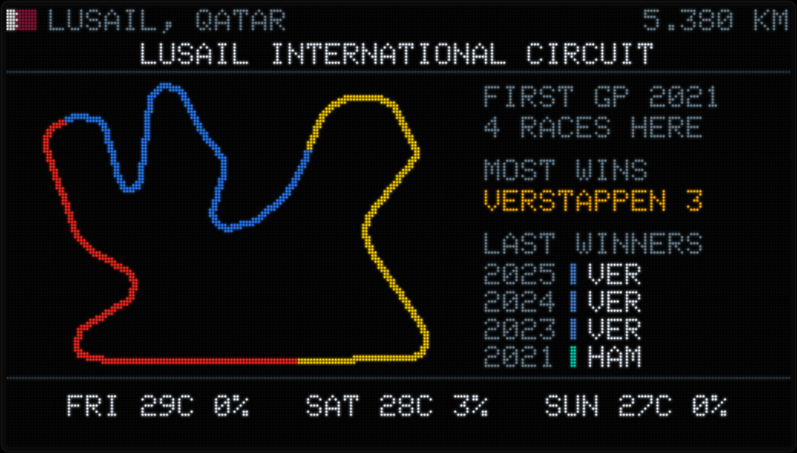 |
| **The next race:** countdown and the weekend in your time zone | **The track,** turned as F1 TV shows it, in sectors |
| 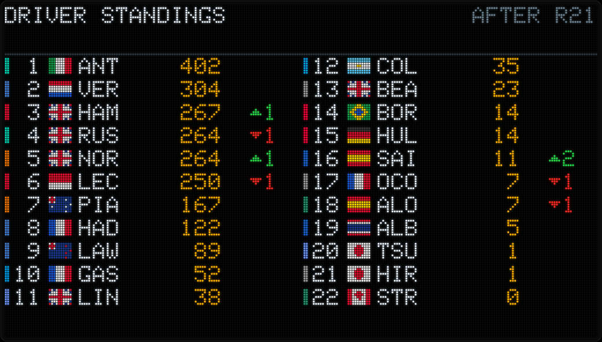 | 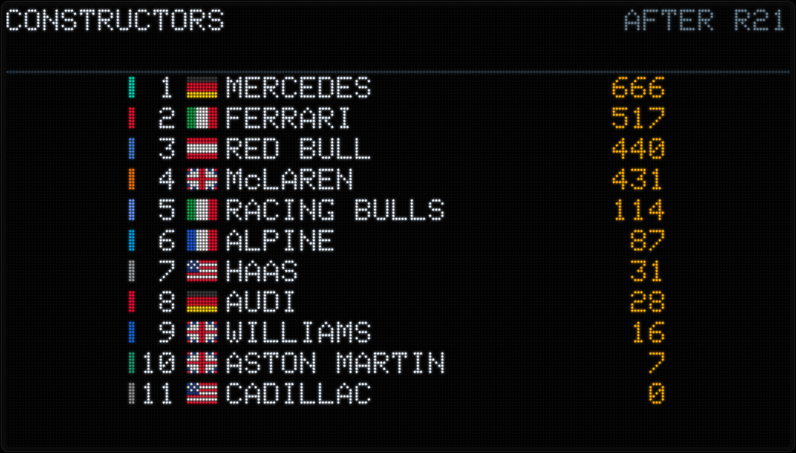 |
| **Driver standings,** with each driver's flag | **Constructors,** with each team's home |
| 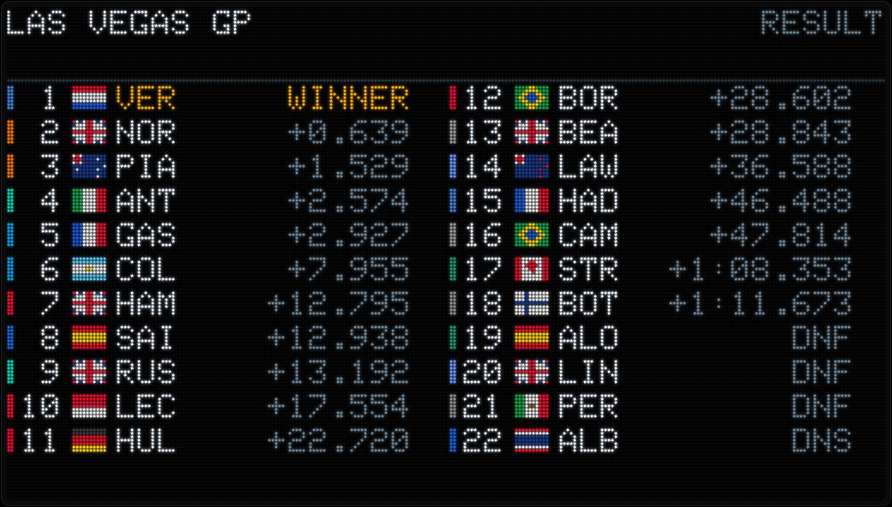 | 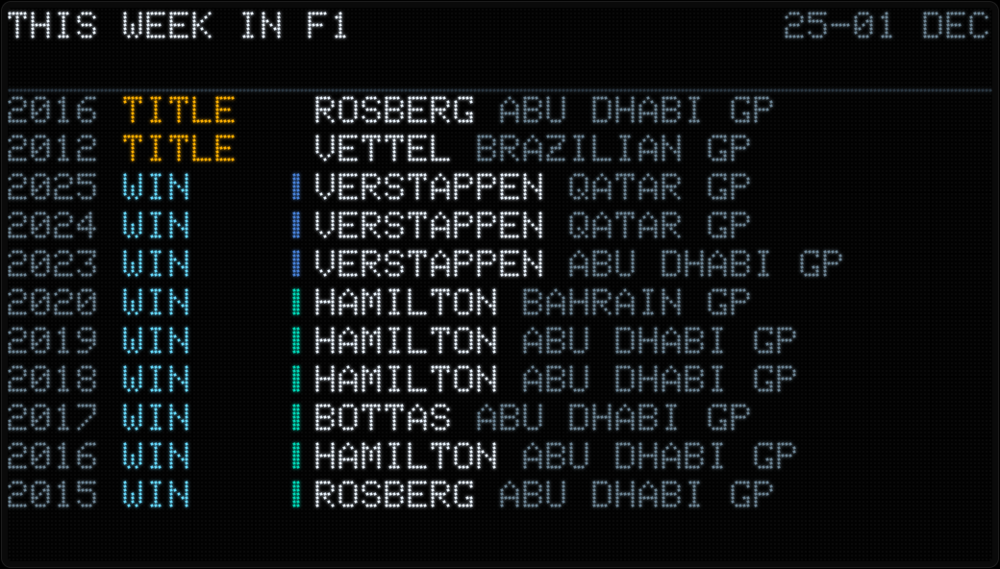 |
| **The last race's result** | **On this day** in F1 |
| 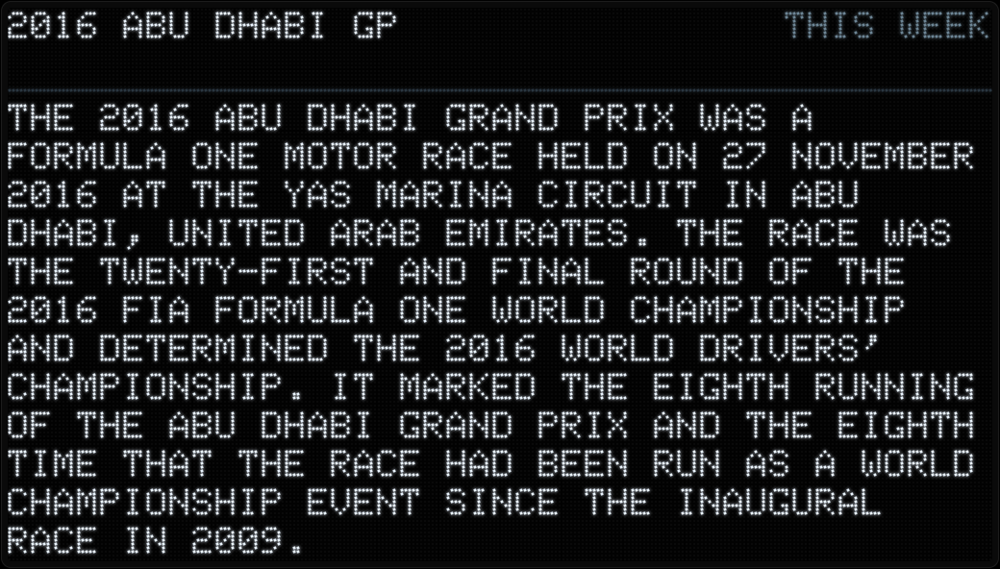 | 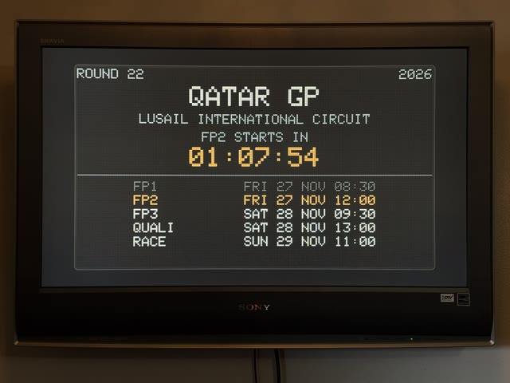 |
| **The day's story,** from Wikipedia | **On a real TV,** cast from a Chromecast |
| 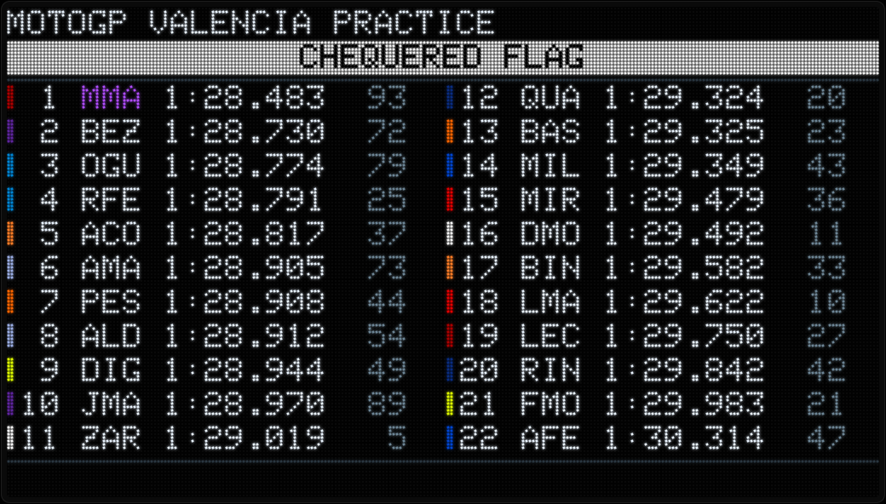 | 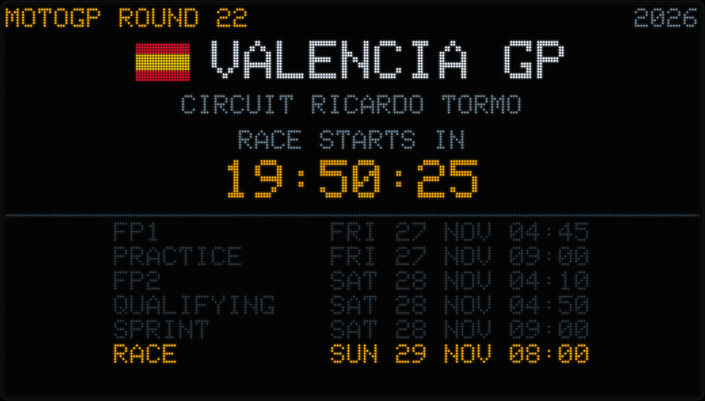 |
| **MotoGP** too: its own timing tower | **MotoGP between sessions:** the next round, standings, the latest result |

---

## What it shows

**During a session** (from 15 minutes before it starts until 90 minutes after
a race ends, or 30 minutes after practice or qualifying):

- the running order in two columns of eleven, each car with its team colour
- a value column that cycles every 8 s: interval, gap to the leader, last
  lap and places gained or lost since the start in a race; best lap and gap
  in practice and qualifying
- the current tyre and its age, `IN PIT` / `PIT EXIT` / `STOPPED` / `OUT`
- fastest lap holder in purple; knocked-out qualifiers dimmed
- laps (race) or session clock (practice, qualifying)
- track status: green, yellow, safety car, VSC, red flag and chequered flag
  fill the whole band. A red flag stays up until the session restarts, and
  the clock follows F1's own, extensions included
- the latest race control message along the bottom, or the weather
- every 20 s, for 5 s, a map of the track with every car on it as a dot in
  its team colour and code, the top ten down the side, and the start/finish
  line with an arrow for the direction of travel (on the track page too). F1's car
  positions need an F1 TV login, so the dots come from the mini-sectors each
  car has passed this lap, which the free feed does carry: about one every
  200 m, so each dot is within a corner or so of the real car

**Full-screen alerts** take over for 6 s when something happens:

- **Overtake** for a place in the top 10
- **Battle** when two cars in the top 10 cross the line within a second of
  each other two laps running
- **Safety car**, **virtual safety car**, **red flag**, and **green flag**
  when the track clears
- **Chequered flag**, with the winner

The feed has no overtake message, so passes are worked out from the running
order and filtered hard. Places changed in the pits, by a retirement, under a
safety car or on the opening lap don't count. Neither does a burst of changes
at once, which is usually the feed catching up. A missed pass is better than
a false one.

**Between sessions**, 12 s each:

- the next Grand Prix, with a countdown to its next session and the weekend's
  schedule in your time zone
- the track: a map of the circuit, turned the way F1 TV shows it, in its
  three sectors (split evenly by distance from the finish line, so close to
  the real ones rather than exact), with its length, when it first held a
  Grand Prix, who has won there most, the last winners, and the weekend
  forecast once it's within two weeks
- on a sprint weekend, the sprint's result, with the points scored
- qualifying, from when it's run until the race
- driver and constructor standings, with places gained or lost at the last
  round
- the last race's result
- on this day: Grands Prix won on today's date, first wins, titles clinched
  (from 1991) and drivers born on it, then the day's main story in a
  paragraph from Wikipedia, which stays up twice as long. On a quiet day it
  takes in the week around it

Country flags, drawn LED by LED at 10×7, mark the host of the next Grand
Prix, every driver in the standings and results, and each team's home in the
constructors' table.

### MotoGP

MotoGP sessions get the same timing tower: all 22 riders in their team
colours, with best laps and gaps in practice and qualifying, and intervals,
gaps and last laps in a race. The overtake, battle and chequered flag alerts
work the same way. Riders get three-letter codes like F1's; where they'd
clash (Marc and Alex Marquez, Martin, Marini) each takes an initial instead:
`MMA`, `AMA`. MotoGP's live feed has no flags, race control or tyres, so the
bike's number takes the tyre column and the band only shows the chequered
flag.

F1 comes first. A running F1 session always has the board; a MotoGP session
takes it when F1 is between sessions, counting down to one, or holding a
finished session's result.

In the week either side of a MotoGP round, three pages join the cycle between
sessions: the next round with its weekend in your time zone, the riders'
standings with places gained or lost, and the latest race or sprint result.
The rest of the year they stay away. `RACEBOARD_MOTOGP=0` turns MotoGP off.

## Where the data comes from

| What | Source | Notes |
|---|---|---|
| Live timing | `livetiming.formula1.com/signalrcore` | F1's own feed. Unofficial and undocumented; no login needed for timing. Car telemetry and GPS need an F1 TV login, so RaceBoard doesn't use them. |
| Schedule, standings, results, history | [Jolpica](https://github.com/jolpica/jolpica-f1) (`api.jolpi.ca`) | The successor to the Ergast API. Free, no key. Every winner since 1950 is fetched once and kept in `data/history.json`, refreshed weekly. Where each title was clinched, and every driver's birthday, are worked out once (a few minutes of paced requests the first time) and kept in `data/lore.json`. |
| MotoGP: calendar, live timing, standings, results | MotoGP's own API (`api.motogp.pulselive.com`) | The one motogp.com runs on. Unofficial and undocumented; no login. Live timing is polled every 4 s, only while a MotoGP session is on. Standings and results are kept in `data/motogp.json`. |
| Race weekend forecast | [Open-Meteo](https://open-meteo.com/) | Free, no key. |
| The day's story | [Wikipedia](https://en.wikipedia.org/) | The summary of the race or driver, through its REST API. Free, no key. Kept in `data/lore.json`. |
| Track maps | [MultiViewer](https://multiviewer.app/) (`api.multiviewer.app`) | F1's own track outline and the rotation F1 TV uses, as the live timing apps draw them. Free, no key. Kept in `data/circuits/`, refreshed monthly. |
| Track lengths, and maps MultiViewer lacks | [bacinger/f1-circuits](https://github.com/bacinger/f1-circuits) | MIT licence. A copy is kept in `backend/circuits.geojson`, so no download is needed. A circuit missing from both gets the track page without a map. |

F1 can change the live feed whenever it likes. If the feed stops answering,
the board falls back to the schedule pages, and a feed that drops mid-session
shows `NO FEED` in the corner instead of freezing silently.

## The spoiler delay

The timing feed runs **ahead of every TV broadcast**, often by a lot on a
streaming service. With no delay, the board shows a pass before you see it.
Set `RACEBOARD_DELAY_S` in `raceboard.env` to hold every update that many
seconds. Start around 30 and adjust until the board moves just after the TV.

## Install

You need a Linux machine that stays on (a Raspberry Pi is plenty) with
Python 3.10 or newer and git. RaceBoard runs in its own virtualenv as one
systemd service.

```bash
git clone https://github.com/gonzalu/RaceBoard.git ~/RaceBoard
cd ~/RaceBoard
python3 -m venv .venv
.venv/bin/pip install -r backend/requirements.txt
cp raceboard.env.example raceboard.env      # then edit: delay, time zone
```

Try it:

```bash
set -a; . ./raceboard.env; set +a
.venv/bin/uvicorn backend.main:app --host 0.0.0.0 --port 8093 --no-access-log
```

`--no-access-log` keeps uvicorn from logging every request. Each open screen
asks for an update once a second, which would otherwise bury everything else.

Open `http://<that machine's address>:8093/`.

Run it at boot:

```bash
sed "s#YOUR-USER#$USER#g" raceboard.service | sudo tee /etc/systemd/system/raceboard.service >/dev/null
sudo systemctl daemon-reload && sudo systemctl enable --now raceboard
```

Check it's healthy:

```bash
systemctl status raceboard --no-pager
journalctl -u raceboard -n 20 --no-pager
```

You want a `live timing: subscribed` line and `200 OK` from `api.jolpi.ca`.

## Updating

```bash
cd ~/RaceBoard && git pull
.venv/bin/pip install -r backend/requirements.txt
sed "s#YOUR-USER#$USER#g" raceboard.service | sudo tee /etc/systemd/system/raceboard.service >/dev/null
sudo systemctl daemon-reload && sudo systemctl restart raceboard
```

Your `raceboard.env` and recordings are untouched. Screens already showing the
board reload themselves.

## Getting it onto a TV

### Option A: Chromecast

The Chromecast loads the page and renders it itself, so no computer has to
stay awake driving the picture. [catt](https://github.com/skorokithakis/catt)
does the casting. Install it in RaceBoard's virtualenv and find your
Chromecast's exact name:

```bash
.venv/bin/pip install catt
.venv/bin/catt scan
```

Then cast the board to it, using the name exactly as `catt scan` printed it:

```bash
.venv/bin/catt -d "YOUR-CHROMECAST" cast_site "http://YOUR-SERVER-IP:8093/"
```

> **Use the IP address, not a hostname.** A Chromecast uses Google's DNS
> servers and ignores the one your router hands out, so a name that resolves
> everywhere else on your network fails on the stick. If the server's address
> can change, give it a DHCP reservation in your router.

> `catt` prints *Casting…* as soon as the Chromecast accepts the URL, before
> it has tried to load anything. Look at the TV to be sure.

The cast lasts until the Chromecast reboots or someone casts something else
to it. Run the same command again to put the board back.

`cast_site` uses the DashCast receiver, which isn't a documented Google
feature. It works on classic Chromecast sticks and the Chromecast Ultra, but
**not** on Chromecast with Google TV. Use Option B for those.

Classic Chromecasts run an old built-in browser (roughly Chrome 70s) that
never gets updated. RaceBoard's page is written to run on it. If you change
the frontend, avoid newer JavaScript such as `??` and `?.`: one unsupported
operator stops the whole script, and the TV shows an empty black panel.

### Option B: Raspberry Pi on HDMI

The most robust option, with no casting involved. Any spare Pi running
Raspberry Pi OS Lite, with Chromium in kiosk mode:

```bash
sudo apt install chromium-browser cage
cage -- chromium-browser --kiosk --noerrdialogs --disable-infobars \
     --check-for-update-interval=31536000 http://YOUR-SERVER-IP:8093/
```

Make that a systemd service to start it at boot. `cec-utils` can switch the TV
on and off on a schedule over HDMI-CEC.

### Option C: a browser

Open `http://YOUR-SERVER-IP:8093/` and press F11.

Whichever you use, the page reloads itself when RaceBoard is updated on the
server, so a TV picks up changes without being re-cast.

## Recording and replay

F1 no longer serves its session archive without a login, so RaceBoard keeps
its own. Every live session's raw feed is written to `data/recordings/`
(`RACEBOARD_RECORD=0` turns that off). Play one back to work on the board
between race weekends:

```bash
RACEBOARD_REPLAY=data/recordings/2026-11-29_Qatar_Grand_Prix_Race.jsonl \
RACEBOARD_REPLAY_SPEED=4 \
  .venv/bin/uvicorn backend.main:app --port 8093 --no-access-log
```

A plain snapshot (one JSON object, the hub's answer to a subscribe) also
works; it shows that moment frozen.

MotoGP sessions are recorded too, as `*_MotoGP_<round>_<session>.jsonl`, and
play back with `RACEBOARD_MOTOGP_REPLAY`.

## Configuration

All in `raceboard.env`; see `raceboard.env.example` for the full list.

| Variable | Default | |
|---|---|---|
| `RACEBOARD_DELAY_S` | `0` | Spoiler delay, seconds |
| `RACEBOARD_TZ` | server's zone | Time zone for session times, e.g. `America/New_York` |
| `RACEBOARD_RESULT_HOLD_MIN` | `90` | Minutes a finished race or sprint's classification stays up |
| `RACEBOARD_PRACTICE_HOLD_MIN` | `30` | The same for practice and qualifying |
| `RACEBOARD_PRE_SESSION_MIN` | `15` | Minutes before a session the tower appears |
| `RACEBOARD_ALERTS` | `all` | Full-screen alerts: any of `overtake,battle,flag,chequered`, or `none` |
| `RACEBOARD_RECORD` | `1` | Record live sessions to `data/recordings/` |
| `RACEBOARD_REPLAY` | | Replay a recording instead of the live feed |
| `RACEBOARD_REPLAY_SPEED` | `1` | Replay speed multiplier |
| `RACEBOARD_MOTOGP` | `1` | MotoGP's timing tower and pages; `0` turns them off |
| `RACEBOARD_MOTOGP_REPLAY` | | Replay a MotoGP recording instead of its live feed |

## License

Apache 2.0. The bitmap font is Adafruit's glcdfont (BSD). The circuit
outlines are Tomislav Bacinger's f1-circuits (MIT, `backend/circuits.LICENSE`). Formula 1, F1 and
team names are trademarks of their owners; RaceBoard is not affiliated with
or endorsed by Formula 1.
